# Makin' Groceries

[](https://github.com/beauregardhenry/makingroceries/actions/workflows/ci.yml)

An iPhone grocery list built around how you actually shop: separate lists for each store, in the order you walk the aisles.

Requires iOS 26 and Xcode 26. Written in SwiftUI with no third-party dependencies.

## Screenshots

<table>
  <tr>
    <td align="center">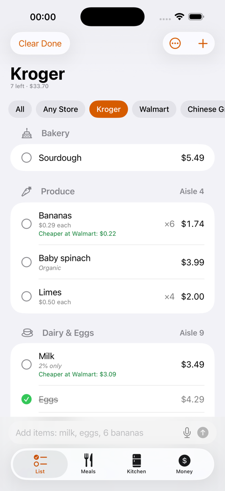<br><sub><b>A store's list</b><br>in the order you walk it, with aisle labels, prices and notes</sub></td>
    <td align="center">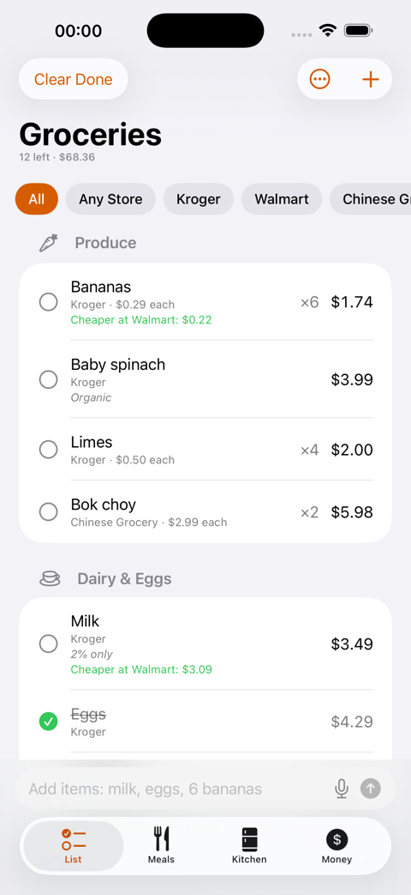<br><sub><b>All stores</b><br>everything together, with what's left and its cost under the title</sub></td>
    <td align="center">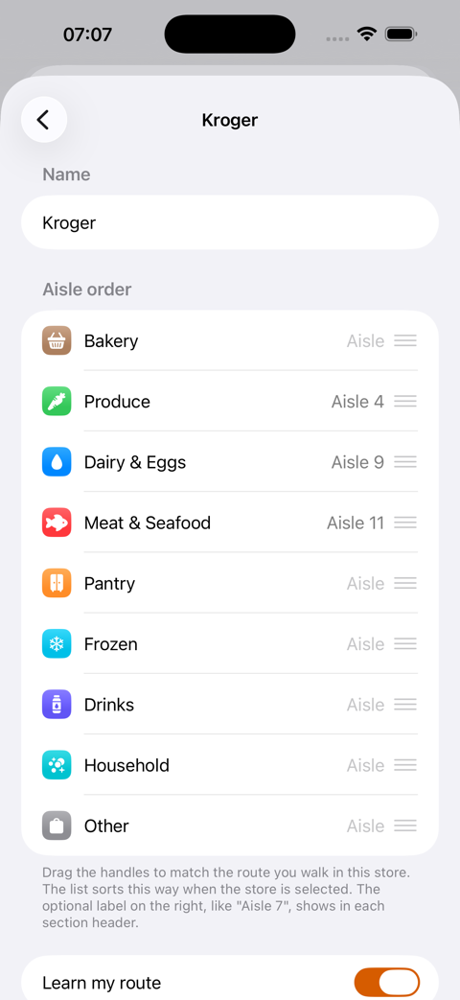<br><sub><b>Aisle map</b><br>drag aisles into your route, add labels like "Aisle 4"</sub></td>
  </tr>
  <tr>
    <td align="center">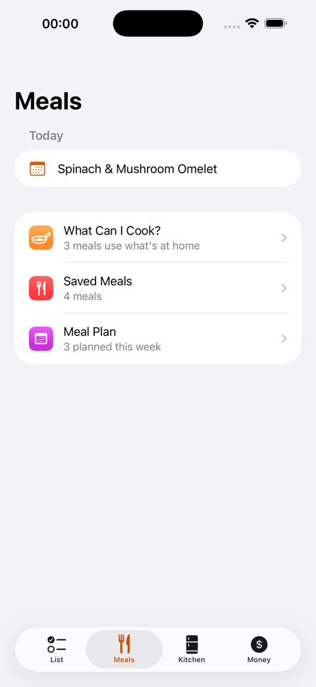<br><sub><b>Meals tab</b><br>what's planned today, cooking ideas, saved meals and the plan</sub></td>
    <td align="center">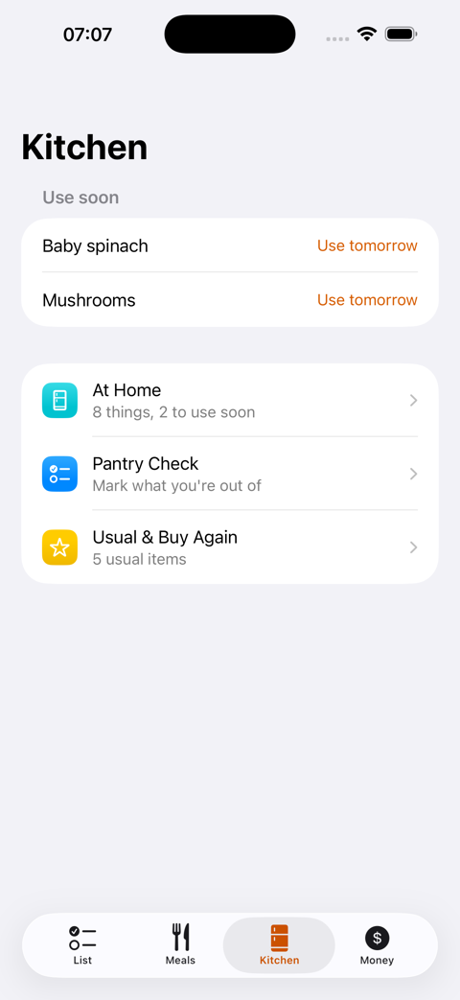<br><sub><b>Kitchen tab</b><br>what to use soon, what's at home, pantry check and usual items</sub></td>
    <td align="center">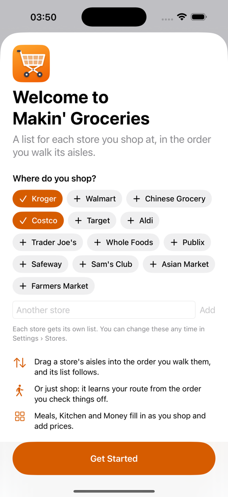<br><sub><b>First launch</b><br>pick the stores you shop at, then get started</sub></td>
  </tr>
  <tr>
    <td align="center">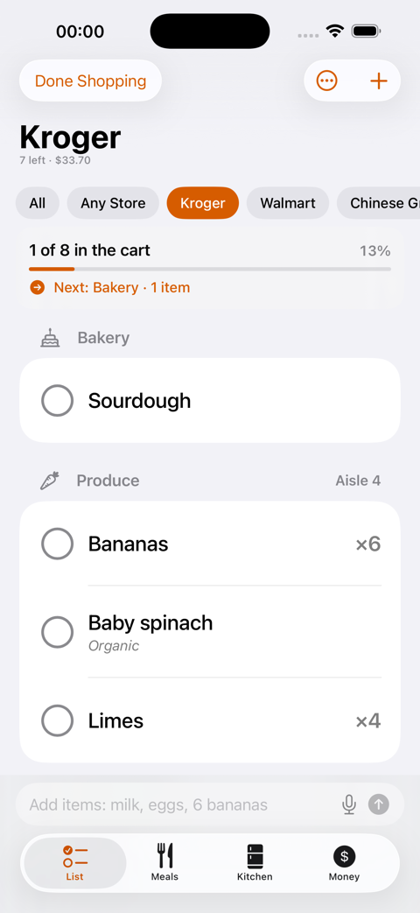<br><sub><b>Shopping Mode</b><br>progress, the next aisle, and big rows with nothing else in the way</sub></td>
    <td align="center">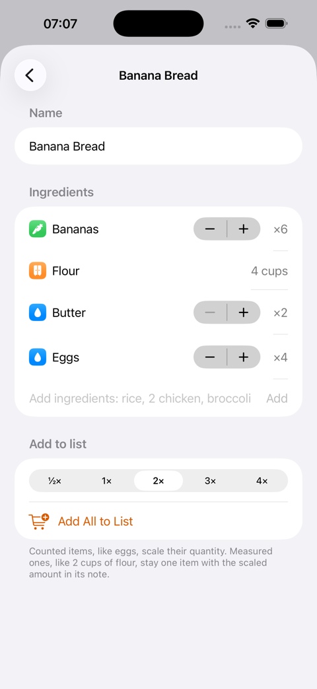<br><sub><b>Meals and scaling</b><br>a 2x batch doubles counted and measured ingredients</sub></td>
    <td align="center">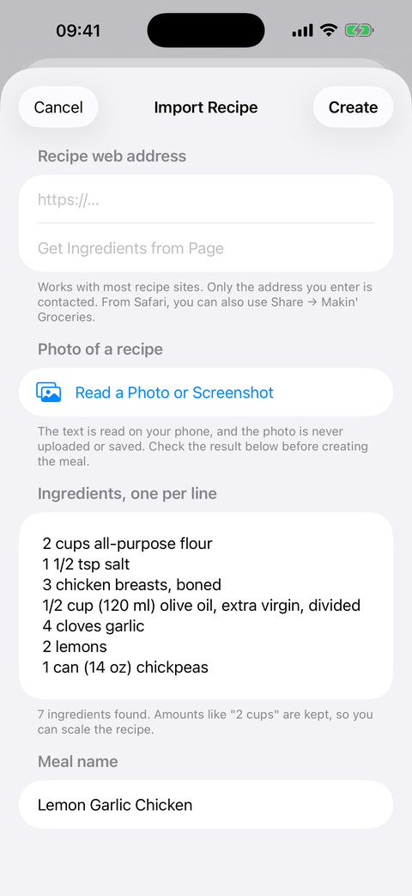<br><sub><b>Recipe from a photo</b><br>ingredients are read on the phone from a picture or screenshot</sub></td>
  </tr>
  <tr>
    <td align="center">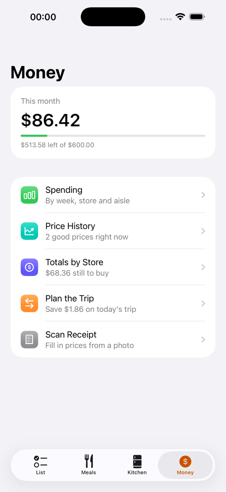<br><sub><b>Money tab</b><br>this month against your budget, prices, totals and the trip plan</sub></td>
    <td align="center">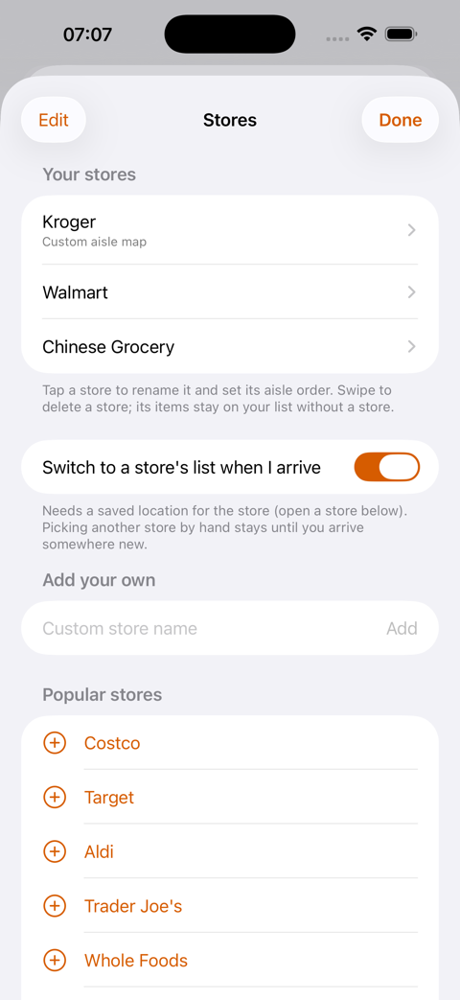<br><sub><b>Stores</b><br>add your own, or pick a popular one</sub></td>
    <td align="center">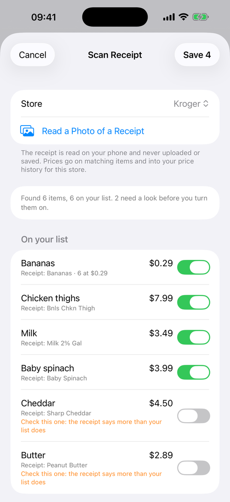<br><sub><b>Receipt scan</b><br>prices read from a photo, matched to your list; uncertain matches stay off</sub></td>
  </tr>
  <tr>
    <td align="center">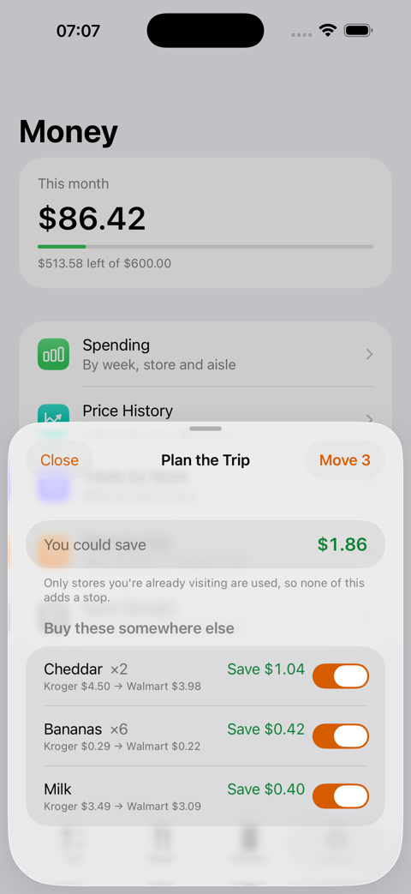<br><sub><b>Plan the Trip</b><br>buy an item at a cheaper store you're already visiting</sub></td>
    <td align="center">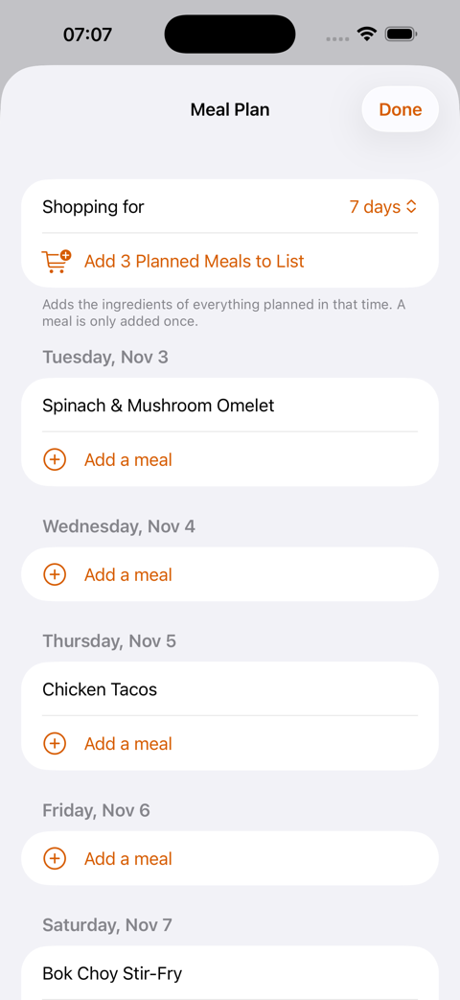<br><sub><b>Meal plan</b><br>plan meals by day, then add the week's ingredients at once</sub></td>
    <td align="center">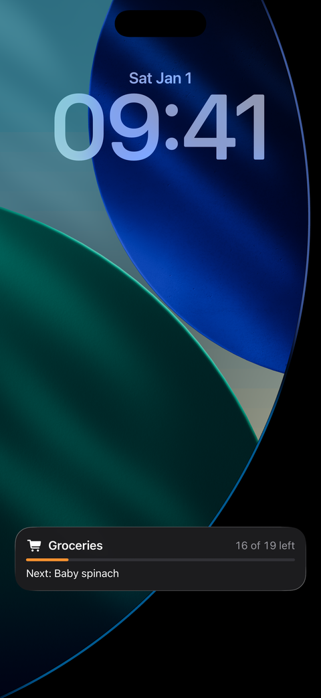<br><sub><b>Live Activity</b><br>how many items are left, and what's next, on the lock screen</sub></td>
  </tr>
</table>

<table>
  <tr>
    <td align="center">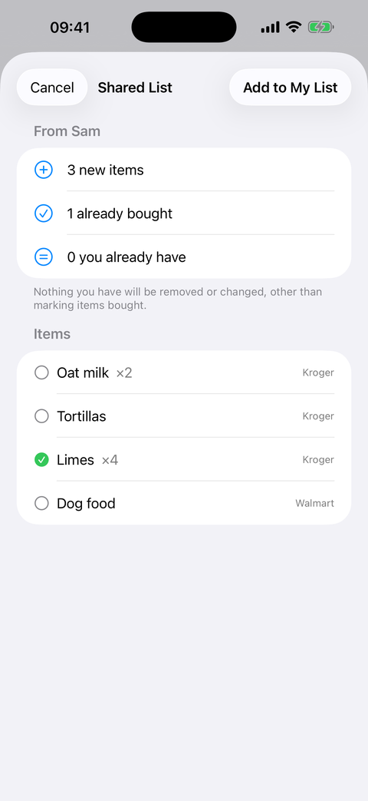<br><sub><b>Send to family</b><br>a list arrives as a file and merges into yours; nothing is removed or duplicated</sub></td>
    <td align="center">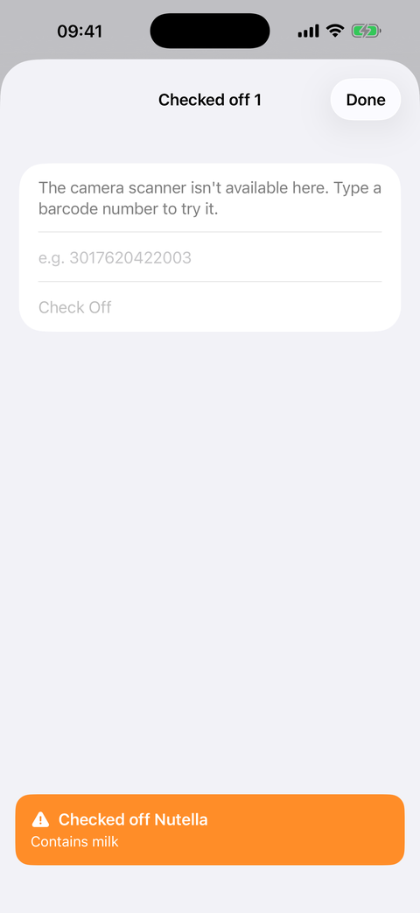<br><sub><b>Scan to check off</b><br>scan an item at the store and it ticks off, with a warning if it contains something you avoid</sub></td>
    <td align="center">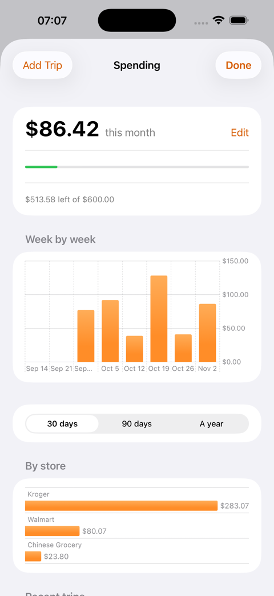<br><sub><b>Spending</b><br>by week, store and aisle, with an optional monthly budget</sub></td>
  </tr>
  <tr>
    <td align="center">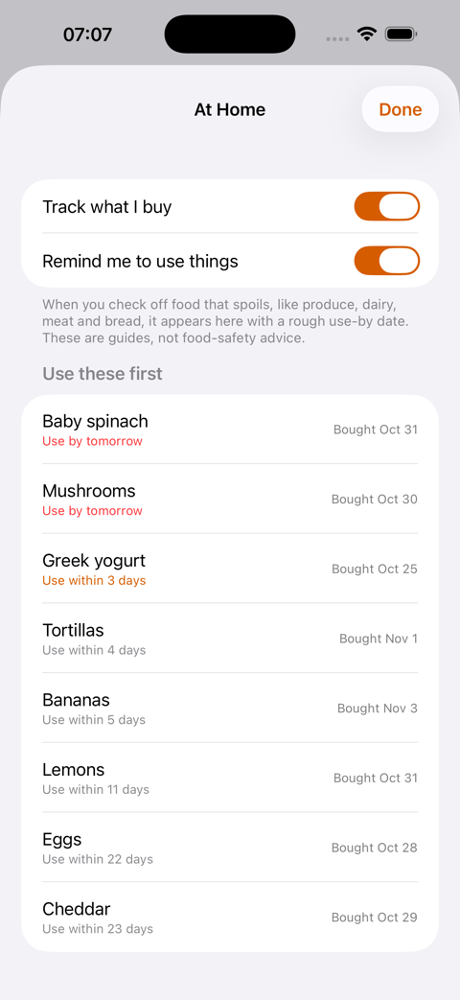<br><sub><b>At Home</b><br>what you bought and when to use it, with morning reminders</sub></td>
    <td align="center">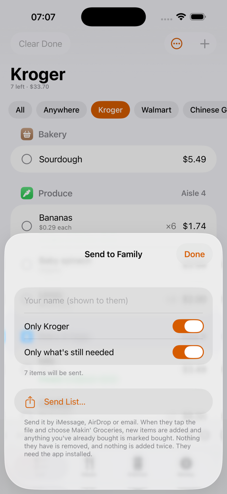<br><sub><b>Send a list</b><br>by iMessage, AirDrop or email</sub></td>
    <td align="center">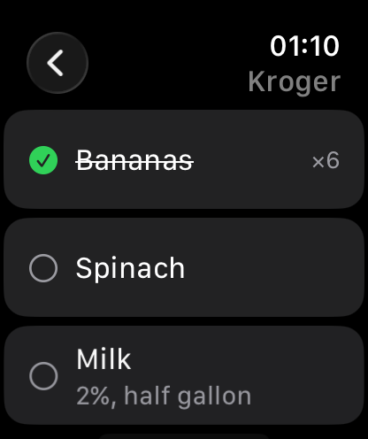<br><sub><b>Apple Watch</b><br>each store's list in walking order; tap to check off, and the phone follows</sub></td>
  </tr>
</table>

The screenshots use made-up demo data. Regenerate them after a visible change, in light mode, so they stay accurate.

## What it does

The first launch asks which stores you shop at and whether to start with a few sample items. Five tabs: **List**, where you shop; **Meals**, for what to cook and plan; **Kitchen**, for what's at home; **Money**, for spending and prices; and **Save Up**, for bigger purchases you're saving toward. Each tab shows what matters now, like what to use soon or how much is left of your budget. Settings (list color, app icon, stores and store types, allergies, iCloud Sync, Live Sync, backups) are under **⋯ › Settings**.

**Lists and stores**
- A list per store (Kroger, Walmart, a Chinese grocery, or any you name), plus **All**, which also holds anything you haven't given a store.
- Per-store **aisle maps** with sixteen sections plus Other: nine for food (Produce, Dairy & Eggs, Meat & Seafood, Bakery, Pantry, Frozen, Drinks, Household, Pharmacy) and seven for non-food (Hardware & Tools, Garden & Outdoor, Electronics, Clothing, Home & Decor, Pet, Toys & Games). Drag them into the order you walk them and add labels like "Aisle 4". The list follows that order, and each section header is a colored band with its icon.
- **Non-food stores**: Target, Walmart, Costco, Home Depot, Lowe's, Best Buy, Menards, Ace Hardware, Petco and PetSmart are in the store presets. Each store has a type (grocery, general or hardware) under its settings; a general store walks food first, a hardware store starts with tools. Items like "hammer", "potting soil", "USB charger" or "dog kibble" are filed in the right aisle automatically.
- **Travel**: a Travel chip is its own list. It starts after your stores; drag it anywhere among them under Stores (the sliders button on the chip bar). Items marked "For a trip" (in the add sheet or an item's details) appear only there, so sunscreen and phone chargers don't clog your grocery lists, the widget or the watch.
- **Learns your route**: as you check things off, the app notices the order you walk a store in and updates its aisle map after a few trips. Dragging the aisles yourself turns this off for that store.
- **Shopping Mode**: made for the store. A card at the top shows how much is in the cart and which aisle to head to next ("Next: Dairy & Eggs, Aisle 9 · 2 items"). Rows get bigger and drop prices and store names, keeping notes and allergy warnings. Checked items tuck into a collapsed "In the cart" section, the screen stays on, and **Done Shopping** (or **Finish Shopping** once everything's in the cart) clears the cart off your list, with Undo.
- Quantities, notes, photos, and items that **repeat** on their own every week, two weeks or month.

**Fast entry**
- **Quick add**: type `milk, 6 bananas, eggs x2` to add several items at once, with autocomplete from past items.
- **Barcode scanner** with a product name lookup from [Open Food Facts](https://world.openfoodfacts.org). Only the barcode number is sent.
- A "usual items" list, a Buy Again list, and **Due** suggestions for things you buy at a steady pace.
- **Meals**: save a list as a meal and add all its ingredients in one tap, at ½×, 2×, 3× or 4× if you're cooking a different batch size. Measured ingredients ("2 cups flour") scale as an amount in the item's note; counted ones ("3 eggs") scale their quantity.
- **Running total**: a bar above the quick-add field adds up everything priced on the list you're looking at, shows what's already in the cart, and (when one store or Travel is selected) the total across all your everyday lists.
- **Save Up**: its own tab for purchases you're saving toward, each with a cost, like fixing the van or buying a computer. Drag them into priority order (tap Edit); the first one is funded first. Put money aside as you go, and set how much you can put away each month to see roughly when each goal will be funded. **Something unexpected came up** adds a surprise expense in one tap: urgent ones jump to the top and show how far they push everything else back, or, if you've set up a **rainy-day fund** (a goal that holds money for surprises), a small expense is paid from it and nothing else moves. Bought goals move to a Bought list. Goals sync with iCloud and are included in backups.
- **Recipe categories**: saved meals are grouped under Breakfast, Lunch, Dinner, Soups & Stews, Sides, Snacks, Desserts and Drinks, each with its own color. Imported recipes are sorted by name; change a meal's category in its editor.
- **Company Coming**: under Meals. It reads your calendar (Apple Calendar and any Google Calendar added in Settings › Calendar › Accounts, so there's no separate Google sign-in) for dinners, parties and visits in the next three weeks. Pick one, or set a date and guest count by hand, and it suggests make-ahead dishes that freeze well: your own meals marked "Freezes well" first, then built-in ideas like lasagna, chili and meatballs. "Plan" puts the dish on the meal plan three days ahead; "Add to List" adds its ingredients scaled for your guests. Calendar access is optional and stays on the phone.
- **Recipe import** from a pasted list, a recipe web page, a **photo or screenshot**, or the **document camera**. Photos are read on the device and never uploaded.
- **Share from Safari**: choose Makin' Groceries in the Share sheet on a recipe page to save it as a meal or add it to your list.
- **Dictation**: tap the microphone on the quick-add bar and say "milk, two limes and a dozen eggs". Recognition runs on the device where the iPhone supports it.
- **Pantry Check**: mark which usual items you're out of, then add them all.
- On phones with Apple Intelligence, an item the keyword list can't place is filed by the on-device language model. Phones without it keep using the keyword list.
- Typos and plurals are caught ("tomatos" becomes "Tomatoes"), and adding something already on the list raises its quantity.

**Prices**
- Optional prices, with what's left to buy and its cost under the list's title, totals by store, and a hint when an item was cheaper at another store you've priced it in.
- **Unit prices**: give an item a size ("16 oz", "1 lb", "12 ct") and the list shows the price per ounce, fluid ounce or piece, so different package sizes compare fairly. Barcode scans fill the size in when the product has one.
- **Spending**: receipts also record the trip total. A Spending screen shows this month against an optional budget, a week-by-week chart, and totals by store and by aisle. You can add a trip by hand too.
- **Receipt scan**: photograph a receipt and prices fill in on matching items and in your price history. It's read on the device. Matches where the receipt says more than your list ("Peanut Butter" for "Butter") are shown but left off until you confirm them.
- **Plan the Trip**: suggests buying an item at a cheaper store that's already on today's trip, so following it never adds a stop.
- **Price history**: every item with a few prices gets a chart of what you've paid at each store, with your usual price marked. A Price History screen lists what's well under its usual price right now, and where each thing you buy often is cheapest on average.

**Around the phone**
- **Home and Lock Screen widget** with a store picker, check-off buttons, and an option to switch to the store you're at.
- **Live Activity** on the lock screen and Dynamic Island while Shopping Mode is on: items left, a progress bar and what's next.
- **Send a list to family without iCloud**: share your list as a small file by iMessage, AirDrop or email. When they open it in their copy of the app, new items are added, anything already bought is marked bought, and nothing is removed or added twice. It isn't live syncing, and needs no developer account.
- **iCloud Sync** (Settings › iCloud Sync): your list, stores, meals, history and everything else stay the same on every iPhone, iPad and Mac signed in to your iCloud account, in your private iCloud storage. Turning it on combines this device's lists with iCloud's without removing anything, changes made on two devices at once are merged, and nothing deleted in iCloud is ever deleted from a device. Off until you turn it on.
- **Live Sync**: phones in the same household keep one list while the app is open on each, directly over Wi-Fi or Bluetooth, with no iCloud or server. Pick a household code and type it on each phone. New items, check-offs, un-checks and deletions are shared, and clearing done items on one phone doesn't bring them back on the other.
- **Scan to check off**: scan items as they go in the cart and each is checked off your list. The app remembers each barcode after the first scan.
- **Allergies & avoid list**: name the foods you avoid, and scanned or looked-up products that contain them are flagged. The data comes from Open Food Facts and can be wrong, so read labels if you have an allergy.
- **At Home**: food you check off is tracked with a rough use-by date, with a quiet 9 am reminder the day before. Swipe to mark it used, buy it again, or toss it. The dates are guides, not food-safety advice.
- **Auto-switch store**: arriving at a store you've saved a location for switches the list to it. Choosing another store by hand sticks until you arrive somewhere new.
- **Alternate app icons**: the shopping cart icon in orange, lime, berry or midnight.
- **Meal plan**: assign meals to days, then add everything planned for the next few days to the list in one tap.
- **What Can I Cook?**: your saved meals that use what's At Home, with the ones that use up food going off soonest first, and one tap to add only the missing ingredients. On phones with Apple Intelligence, the on-device model also suggests new dishes from what you have, which you can save and plan for today.
- Haptics when you check something off and a stronger one when you finish an aisle.
- **Apple Watch app** (optional, see below): your lists in walking order, with check-off from your wrist.
- **Siri and Shortcuts**: "Add to my list in Makin' Groceries", "Read my grocery list in Makin' Groceries".
- **Controls**: put **Add to List** or **Start Shopping** in Control Center, on the Lock Screen, or on the Action button. Add to List opens the app with the quick-add bar ready; Start Shopping opens Shopping Mode on the store you're at.
- **Spotlight**: search from the Home Screen to find a saved meal, an item on your list, or something you've bought before. Tapping a past item opens the quick-add bar with it typed in.
- **Arrival reminders**: save a store's location and get a notification listing what you need when you arrive. Locations stay on the device.
- Share the list as text, undo Clear Done, back up and restore everything to a file, a list color in Settings (grey, five tints, a custom color, or Dark). Colors sit on top of light mode, and Dark is the only choice that switches the whole app to dark mode.

## Privacy

Everything is stored on your phone. If a saved file ever can't be read, the app keeps a copy in a Recovered folder and tells you, rather than starting over, and changes made from the widget, Siri or the share sheet are merged with the app's instead of overwriting them. Receipts, recipe photos, dictation (where supported) and the on-device language model all run on the device. Live Sync talks only to phones on the same network that use your household code, encrypted, and the code itself is never broadcast. Spotlight entries stay in the phone's own search index. The app has no account and no server. It contacts the internet only to look up a barcode (the number only, which also returns allergens and size) and to fetch a recipe page when you enter its address or share it from Safari.

## Building it

The Xcode project is generated from `Grocery/project.yml` with [XcodeGen](https://github.com/yonaskolb/XcodeGen), so change settings there rather than in Xcode, which would be overwritten the next time the project is regenerated.

```bash
brew install xcodegen
cd Grocery
xcodegen generate
open Grocery.xcodeproj
```

To run on your own iPhone, change these in `Grocery/project.yml`:
- `DEVELOPMENT_TEAM` to your Apple team ID
- the three `PRODUCT_BUNDLE_IDENTIFIER` values (the widget's and the share extension's must start with the app's)
- the app group name, in `project.yml`, all three `.entitlements` files and `Grocery/Shared/Models.swift` (`Storage.groupID`)

Then regenerate and press Run. A free Apple ID is enough, but builds expire after 7 days, and iCloud Sync needs a paid Apple Developer membership: to build with a free Apple ID, delete the three iCloud and push keys and the remote-notification background mode from the Grocery target in `project.yml`. If Xcode rejects the app group on a free account, remove it from both targets. The app then keeps its data inside itself, and the widget and Siri can't see your list.

### Apple Watch app

The Watch app is included in the repo but isn't embedded in the iPhone app by default, because embedding it makes every build require the watchOS platform in Xcode (Xcode > Settings > Components). To turn it on, install that platform, uncomment `- target: GroceryWatch` in `Grocery/project.yml`, set your team on the new target, and regenerate. The phone and watch talk through WatchConnectivity, so the watch shows the lists after the phone app has opened once with the watch nearby. It has been run in a paired iPhone and Apple Watch simulator: the phone's lists arrive on the watch, and checking an item off on the watch checks it off on the phone. It hasn't been tried on a real watch yet. To try the watch app alone in the simulator, launch it with the `-demo` argument for a sample list.

## Development and CI

```bash
./scripts/test.sh      # build everything and run the unit tests on an iPhone simulator
./scripts/ui-test.sh   # drive the real app through the main screens (a few minutes)
./scripts/build-watch.sh  # build the Apple Watch app for the watchOS simulator
```

Every pull request and push to `main` runs all three in GitHub Actions, plus four more checks: zero tolerance for `as!`, `fatalError(`, `print(` and `TODO`/`FIXME` in the app sources; test-count floors and a coverage floor that can only rise (the numbers live in `test-count-baseline.txt` and `coverage-baseline.txt` and are raised automatically after merges); and a check that the checked-in Xcode project hasn't drifted from the sources. See [CONTRIBUTING.md](CONTRIBUTING.md).

CI runs on GitHub's macOS 26 runners with the newest Xcode 26 they have. If GitHub has no Mac free and cancels a run before any job starts, it is re-run automatically, up to three attempts.

## Layout

| Folder | Contents |
| --- | --- |
| `Grocery/Sources` | The app's screens |
| `Grocery/Shared` | Data model, storage, parsing and Siri actions, used by the app and the widget |
| `Grocery/Widget` | The widget |
| `Grocery/ShareExtension` | The Safari Share sheet extension |
| `Grocery/Watch` | The Apple Watch app |
| `Grocery/Tests` | Unit tests for everything in `Shared`, and UI smoke tests for the screens |
| `scripts` | Test, coverage and CI check scripts |
| `.github/workflows` | CI and the baseline ratchets |
| `docs/screenshots` | The README's pictures |
| `tools/make_icon.py` | Draws the shopping cart app icons, the alternates and the Watch icon: `python3 tools/make_icon.py` |

## Not done yet

Sharing a list between family members' phones needs iCloud sharing, which needs a paid Apple Developer account.
