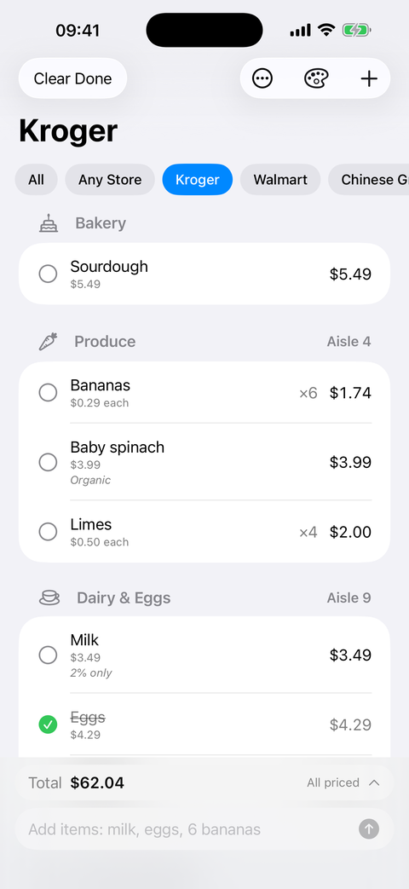
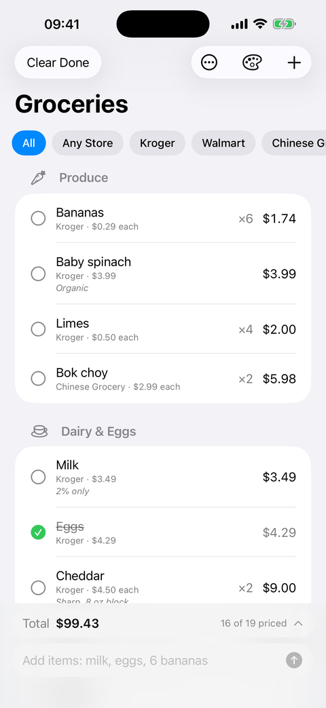
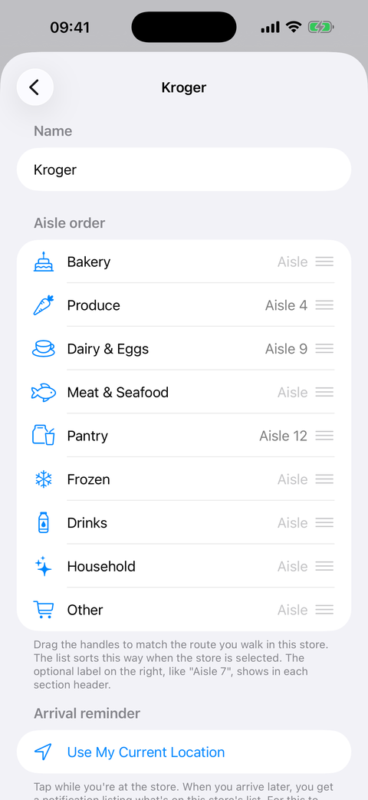
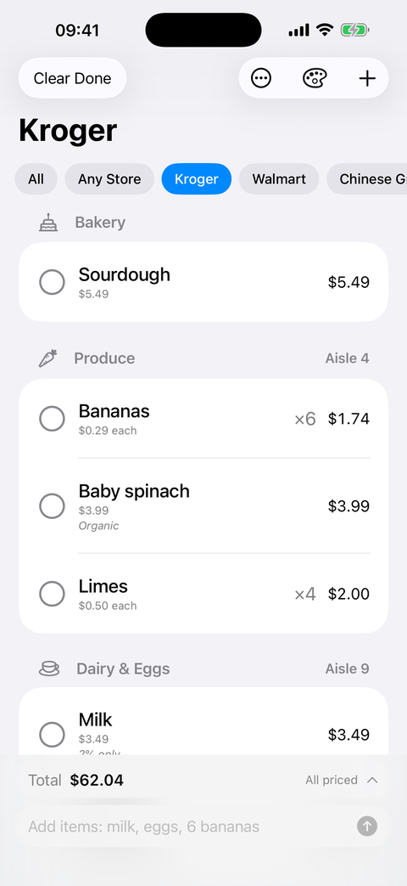
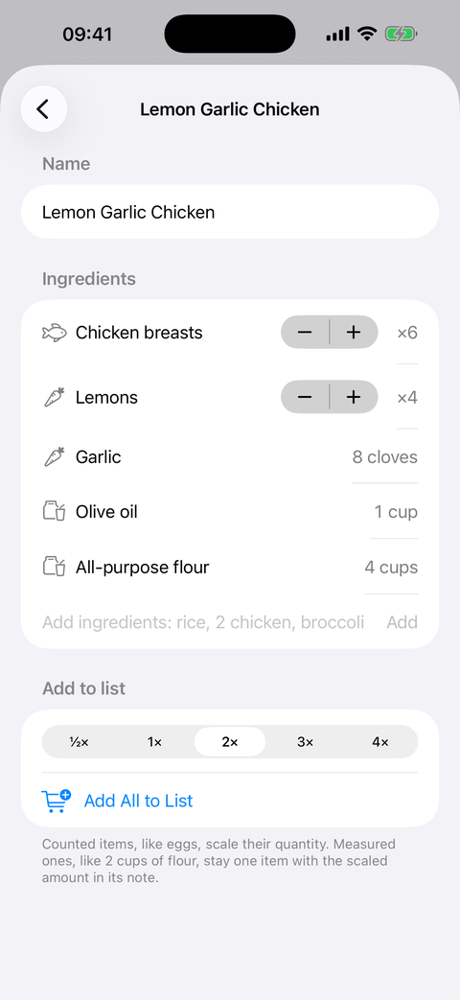
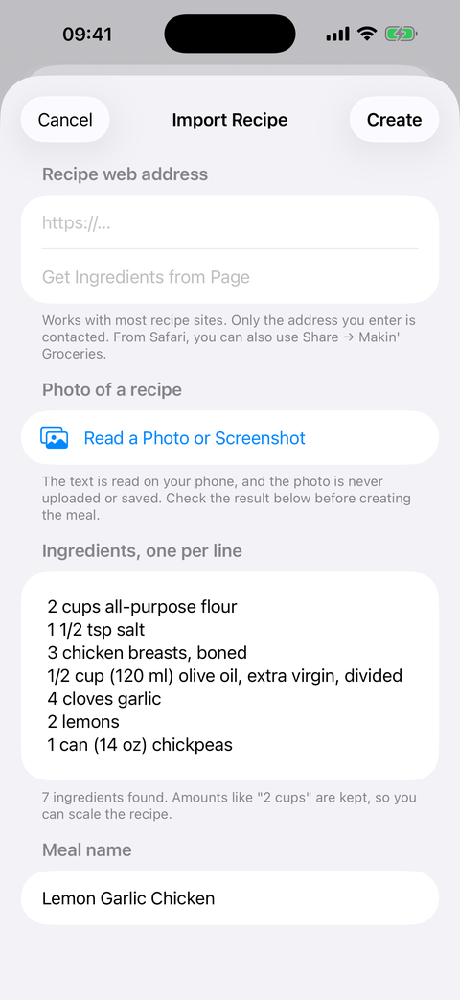
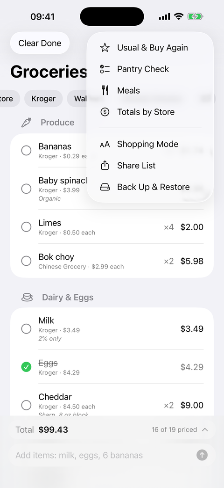
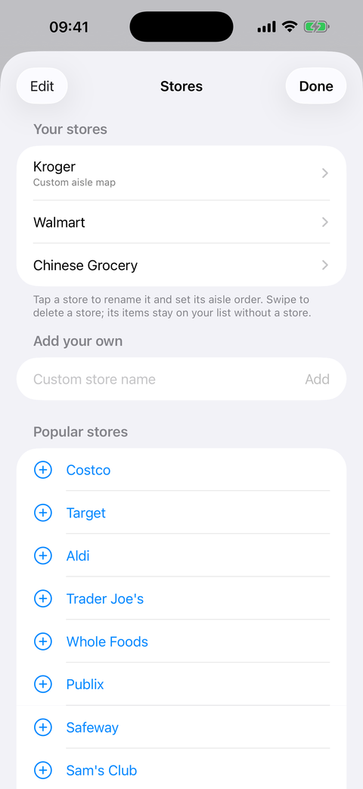

# Makin' Groceries

An iPhone grocery list built around how you actually shop: separate lists for each store, in the order you walk the aisles.

Requires iOS 26 and Xcode 26. Written in SwiftUI with no third-party dependencies.

## Screenshots

<table>
  <tr>
    <td align="center"><br><sub><b>A store's list</b><br>in the order you walk it, with aisle labels, prices and notes</sub></td>
    <td align="center"><br><sub><b>All stores</b><br>everything together, each item tagged with its store</sub></td>
    <td align="center"><br><sub><b>Aisle map</b><br>drag aisles into your route, add labels like "Aisle 4"</sub></td>
  </tr>
  <tr>
    <td align="center"><br><sub><b>Shopping Mode</b><br>bigger text and rows; checked items drop to the cart</sub></td>
    <td align="center"><br><sub><b>Meals and scaling</b><br>a 2x batch doubles counted and measured ingredients</sub></td>
    <td align="center"><br><sub><b>Recipe from a photo</b><br>ingredients are read on the phone from a picture or screenshot</sub></td>
  </tr>
  <tr>
    <td align="center"><br><sub><b>The menu</b><br>usual items, pantry check, meals, totals, sharing and backup</sub></td>
    <td align="center"><br><sub><b>Stores</b><br>add your own, or pick a popular one</sub></td>
    <td></td>
  </tr>
</table>

The screenshots use made-up demo data. Regenerate them after a visible change, in light mode, so they stay accurate.

## What it does

**Lists and stores**
- A list per store (Kroger, Walmart, a Chinese grocery, or any you name), plus **All** and **Any Store** views.
- Per-store **aisle maps**: drag the aisles into the order you walk them and add labels like "Aisle 4". The list follows that order.
- **Shopping Mode**: bigger text and rows, with checked items moved to an "In the cart" section.
- Quantities, notes, photos, and items that **repeat** on their own every week, two weeks or month.

**Fast entry**
- **Quick add**: type `milk, 6 bananas, eggs x2` to add several items at once, with autocomplete from past items.
- **Barcode scanner** with a product name lookup from [Open Food Facts](https://world.openfoodfacts.org). Only the barcode number is sent.
- A "usual items" list, a Buy Again list, and **Due** suggestions for things you buy at a steady pace.
- **Meals**: save a list as a meal and add all its ingredients in one tap, at ½×, 2×, 3× or 4× if you're cooking a different batch size. Measured ingredients ("2 cups flour") scale as an amount in the item's note; counted ones ("3 eggs") scale their quantity.
- **Recipe import** from a pasted list, a recipe web page, a **photo or screenshot**, or the **document camera**. Photos are read on the device and never uploaded.
- **Share from Safari**: choose Makin' Groceries in the Share sheet on a recipe page to save it as a meal or add it to your list.
- **Pantry Check**: mark which usual items you're out of, then add them all.
- Typos and plurals are caught ("tomatos" becomes "Tomatoes"), and adding something already on the list raises its quantity.

**Prices**
- Optional prices, a running total, totals by store, and a hint when an item was cheaper at another store you've priced it in.

**Around the phone**
- **Home and Lock Screen widget** with a store picker and check-off buttons.
- **Siri and Shortcuts**: "Add to my list in Makin' Groceries", "Read my grocery list in Makin' Groceries".
- **Arrival reminders**: save a store's location and get a notification listing what you need when you arrive. Locations stay on the device.
- Share the list as text, undo Clear Done, back up and restore everything to a file, light and dark mode, and a color picker for the background.

## Privacy

Everything is stored on your phone. The app has no account and no server. It contacts the internet only to look up a barcode (the number only) and to fetch a recipe page when you enter its address or share it from Safari.

## Building it

The Xcode project is generated from `Grocery/project.yml` with [XcodeGen](https://github.com/yonaskolb/XcodeGen), so change settings there rather than in Xcode, which would be overwritten the next time the project is regenerated.

```bash
brew install xcodegen
cd Grocery
xcodegen generate
open Grocery.xcodeproj
```

To run on your own iPhone, change these in `Grocery/project.yml`:
- `DEVELOPMENT_TEAM` to your Apple team ID
- the three `PRODUCT_BUNDLE_IDENTIFIER` values (the widget's and the share extension's must start with the app's)
- the app group name, in `project.yml`, all three `.entitlements` files and `Grocery/Shared/Models.swift` (`Storage.groupID`)

Then regenerate and press Run. A free Apple ID is enough, but builds expire after 7 days. If Xcode rejects the app group on a free account, remove it from both targets. The app then keeps its data inside itself, and the widget and Siri can't see your list.

## Layout

| Folder | Contents |
| --- | --- |
| `Grocery/Sources` | The app's screens |
| `Grocery/Shared` | Data model, storage, parsing and Siri actions, used by the app and the widget |
| `Grocery/Widget` | The widget |
| `Grocery/ShareExtension` | The Safari Share sheet extension |
| `docs/screenshots` | The README's pictures |
| `tools/make_icon.py` | Draws the app icon: `python3 tools/make_icon.py` |

## Not done yet

Sharing a list between family members' phones needs iCloud sharing, which needs a paid Apple Developer account.
